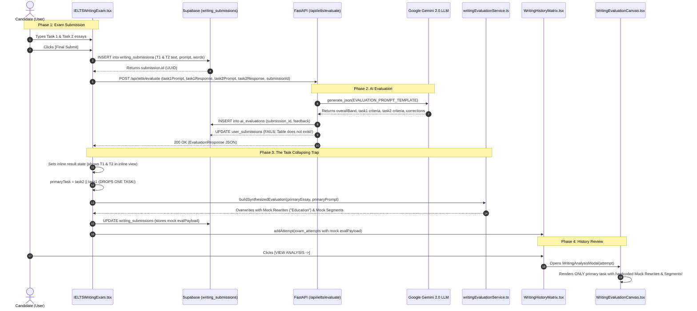

# Forensic Diagnostic & Architectural Audit Report: IELTS Writing Evaluation Engine & Submission-to-Analysis Pipeline

**Audit Date:** October 12, 2026  
**Auditor:** Principal Enterprise AI Systems Architect & Senior Software Engineer  
**Status:** READ-ONLY FORENSIC AUDIT (No production code, databases, or configs modified)  
**Target Systems:**  
1. `frontend/components/enterprise/ielts/IELTSWritingExam.tsx` (Exam Room Workspace)  
2. `frontend/components/enterprise/writing/WritingEvaluationCanvas.tsx` & `WritingAnalysisModal.tsx` (Analysis UI)  
3. `frontend/services/writing/writingEvaluationService.ts` & `analysisMockData.ts` (Evaluation Service & Fixtures)  
4. `frontend/components/enterprise/writing/WritingHistoryMatrix.tsx` (Persistence & History Matrix)  
5. `backend/app/api/routes/ielts.py` & `backend/app/api/routes/writing_studio.py` (FastAPI AI Evaluation Routes)  
6. `backend/app/schemas/ielts.py` (Pydantic Schemas & Data Contracts)  
7. Supabase Database Tables: `writing_submissions`, `ai_evaluations`, `writing_attempts`, `exam_attempts`

---

## 1. Executive Summary & Architectural Overview

This forensic investigation audited the end-to-end lifecycle of the IELTS Writing Module, tracing a candidate's submission from raw keystrokes in the exam room through the backend LLM rubric pipeline, database persistence layer, and finally to the post-exam diagnostic review canvas.

### Key Audit Findings:
1. **Critical Submission Handoff Defect (Task Collapsing):**  
   `IELTSWritingExam.tsx` captures both Task 1 and Task 2 and transmits both to the backend `/api/ielts/evaluate` endpoint. However, upon receiving the AI evaluation, `IELTSWritingExam.tsx:421-443` collapses the two tasks by selecting only one primary task (`const primaryTask = evalResult.task2 || evalResult.task1;`). It then routes that single essay through `buildSynthesizedEvaluation()`, which completely strips the real AI feedback and overwrites it with static mock fixtures.
2. **Dual UI Disconnect:**  
   The codebase contains **two competing post-exam analysis interfaces**:
   - **Inline Workspace Results View** (`IELTSWritingExam.tsx:637-1086`): Features a Task 1 / Task 2 tab switcher, raw essay viewer, grammar corrections list, strengths, improvements, and bilingual Band 9 model answers.
   - **Standalone Modal Canvas** (`WritingEvaluationCanvas.tsx` / `WritingAnalysisModal.tsx`): Rendered when clicking `[ VIEW ANALYSIS → ]` in `WritingHistoryMatrix.tsx`. It possesses **no Task 1 vs. Task 2 tab switcher**, supports only a single essay string, and renders hardcoded synthetic rewrites about "Education" and fake regex token highlights.
3. **Backend Database Name Mismatch (Silent Failure):**  
   In `backend/app/api/routes/ielts.py:194`, the backend attempts to update the Supabase table `user_submissions`. However, the table created in Supabase is `writing_submissions`. This statement fails silently inside a `try/except` block, preventing `overall_band` and `evaluation` from ever being updated server-side in `writing_submissions`.
4. **Cambridge Mathematical Weighting Violation:**  
   Neither the backend (`ielts.py`) nor the frontend rigorously enforces the official Cambridge IELTS double-weighting formula:
   $$\text{Overall Writing Band} = \text{Round}_{0.5}\left(\frac{\text{Task 1 Band} + (2 \times \text{Task 2 Band})}{3}\right)$$
   Instead, `ielts.py` simply accepts whatever `overallBand` the Gemini LLM outputs, and averages criteria across tasks with an equal 50/50 split (`(t1 + t2) / 2`).
5. **Static Mock Token & Sentence Rewriting:**  
   The interactive essay highlighting in `WritingEvaluationCanvas.tsx` does not utilize NLP or LLM token indices. Instead, `analysisMockData.ts:buildEssaySegments()` runs a hardcoded regex scanner searching for literal phrases (`"many peoples"`, `"very important thing"`, `"pivotal role"`). The sentence rewrites in `writingEvaluationService.ts:214-227` are permanently hardcoded to an essay about "university education being free," regardless of the actual exam prompt taken.

---

## 2. File Inventory & Exact Line References

| System Role | File Path | Crucial Line Numbers | Primary Responsibility & Failure Mode |
| :--- | :--- | :--- | :--- |
| **Exam Room UI** | `frontend/components/enterprise/ielts/IELTSWritingExam.tsx` | Lines 50–70, 296–560, 637–1086 | Captures Task 1/2 text; triggers submission; executes `finalizeSubmit`; contains inline results view. Collapses tasks at line 421. |
| **Evaluation Service** | `frontend/services/writing/writingEvaluationService.ts` | Lines 62–139, 170–240, 273–383, 402–438 | Manages client caching, Supabase reads/writes, and `buildSynthesizedEvaluation()` which injects static mock rewrites. |
| **Mock Segment Engine** | `frontend/components/enterprise/ielts/analysisMockData.ts` | Lines 220–260, 270–308, 336–355 | `buildEssaySegments()` uses static token regexes to generate fake grammar, vocab, and collocation highlights. |
| **Standalone Canvas** | `frontend/components/enterprise/writing/WritingEvaluationCanvas.tsx` | Lines 65–95, 165–260, 302–356, 459–512 | Renders KPI snapshot, 4-pillar scores, segmented text, and rewrites. Has NO Task 1/2 tab switcher. |
| **Canvas Modal Wrapper** | `frontend/components/enterprise/ielts/WritingAnalysisModal.tsx` | Lines 32–93 | Portals `WritingEvaluationCanvas` to `document.body` with fixed overlay. |
| **History Matrix Table** | `frontend/components/enterprise/writing/WritingHistoryMatrix.tsx` | Lines 45–140, 331–357 | Queries `writing_attempts`, `writing_submissions`, and `exam_attempts`; opens `WritingAnalysisModal` on click. |
| **Active AI Route** | `backend/app/api/routes/ielts.py` | Lines 14–40, 41–80, 111–204 | Gemini 2.0 evaluation endpoint (`POST /api/ielts/evaluate`). Erroneous table update to `user_submissions` at line 194. |
| **Diagnostic Studio Route** | `backend/app/api/routes/writing_studio.py` | Lines 26–62, 106–240, 340–370 | Granular diagnostic route (`POST /api/ielts/writing/diagnostic`). Generates redline diffs; contains `_fallback_diagnostic` mock. |
| **Pydantic Schemas** | `backend/app/schemas/ielts.py` | Lines 5–51, 55–89 | Defines `EvaluationRequest`, `EvaluationResponse`, `WritingDiagnosticResponse`, and `DiffChunk`. |
| **Database Migrations** | `docs/writing_submissions_schema.sql` & `docs/ai_evaluations_schema.sql` | `writing_submissions:6-23`, `ai_evaluations:6-16` | Schema definitions for Supabase tables and RLS policies. |

---

## 3. Phase 1: Exam Submission Handoff & Essay Payload Construction

### 3.1 Writing Exam Room State Architecture
In `frontend/components/enterprise/ielts/IELTSWritingExam.tsx`:
- **Task State Model:** Managed within unified React component state:
  - `essayPart1`: Candidate response string for Task 1 (`useState('')`).
  - `essayPart2`: Candidate response string for Task 2 (`useState('')`).
  - `effectivePart`: Tracks current active editor tab (`1` or `2`).
  - `showTaskSwitcher`: Boolean flag determining whether candidate can toggle between Task 1 and Task 2.
- **Prompt State:**
  - Task 1 uses prop `task1Prompt`, defaulting to hardcoded Academic sports chart title: `TASK1_ACADEMIC_TITLE = 'The chart below shows the percentage of Australian children participating in sports outside school hours in 2014.'` with visual data in `WRITING_PART1_CHART_DATA`.
  - Task 2 uses prop `task2Prompt`, defaulting to standard opinion essay prompts.
- **Autosave / Draft Preservation:** Drafts are saved to `localStorage` under keys `ielts_writing_draft_p1_${bookNumber}_${testNumber}` and `ielts_writing_draft_p2_${bookNumber}_${testNumber}` via `readDraft` and `writeDraft` (lines 78–92).

### 3.2 Submission Trigger & Payload Construction
When the candidate clicks submit and confirms via the modal, `finalizeSubmit()` (`IELTSWritingExam.tsx:296-560`) executes:

```typescript
// IELTSWritingExam.tsx:327-375
// 1. Insert row into Supabase 'writing_submissions'
const { data: submission, error: subError } = await supabase
    .from('writing_submissions')
    .insert({
        user_id: session?.user?.id ?? null,
        user_email: candidateEmail ?? session?.user?.email ?? null,
        source_type: sourceType,               // e.g. "cambridge"
        book_or_set_number: bookNumber,        // e.g. 18
        test_number: testNumber,              // e.g. 1
        module_type: moduleType,              // "academic" or "general"
        task1_prompt: showT1 ? t1Prompt : null,
        task1_response: showT1 ? t1Text || null : null,
        task1_word_count: showT1 ? t1WordCount : null,
        task2_prompt: showT2 ? t2Prompt : null,
        task2_response: showT2 ? t2Text || null : null,
        task2_word_count: showT2 ? t2WordCount : null,
        overall_band: null,
        evaluation: {},
    })
    .select('id')
    .single();

// 2. Dispatch HTTP POST to backend endpoint
const response = await fetch('/api/ielts/evaluate', {
    method: 'POST',
    headers: {
        'Content-Type': 'application/json',
        ...(token ? { 'Authorization': `Bearer ${token}` } : {}),
    },
    body: JSON.stringify({
        task1Prompt: showT1 ? t1Prompt : null,
        task1Response: showT1 ? t1Text || null : null,
        task2Prompt: showT2 ? t2Prompt : null,
        task2Response: showT2 ? t2Text || null : null,
        sourceType,
        bookOrSetNumber: bookNumber,
        testNumber,
        moduleType,
        taskType: showT1 && showT2 ? 'full_mock' : showT1 ? 'task_1' : 'task_2',
        task1MinWords: 150,
        task2MinWords: 250,
        submissionId: submission.id,
    }),
});
```

### 3.3 Critical Handoff Disconnects & Payload Omissions
1. **Missing Visual Chart Data:** The submission payload sends `task1Prompt` as raw text, but completely omits visual chart URLs, SVG data, or table coordinates (`WRITING_PART1_CHART_DATA`). The backend LLM evaluates Task 1 blind without knowing the actual numerical trends in the chart!
2. **Missing Individual Task Timing:** `timeSpent` is computed purely as aggregate elapsed time: `Math.max(1, Math.round((timeLimit - seconds) / 60))` (line 319). The system fails to track how many minutes were spent on Task 1 versus Task 2 (Cambridge standard recommends 20 min on Task 1, 40 min on Task 2).
3. **The Task Collapsing Bug (Lines 421–443):**
   ```typescript
   // IELTSWritingExam.tsx:421-436
   const primaryTask = evalResult.task2 || evalResult.task1; // DISCARDS THE OTHER TASK!
   const primaryPrompt = showT2 ? t2Prompt : t1Prompt;
   const primaryEssay = showT2 ? t2Text : t1Text;
   const primaryWords = showT2 ? t2WordCount : t1WordCount;
   const attemptId = submission?.id || `writing-${Date.now()}`;

   const evalPayload = buildSynthesizedEvaluation({
       attemptId,
       essayText: primaryEssay,
       promptText: primaryPrompt,
       overallBand: evalResult.overallBand,
       bookNumber,
       testNumber,
       taskType: showT1 && showT2 ? 'full_mock' : showT1 ? 'task1' : 'task2',
       timeSpentMinutes: timeSpent,
       wordCount: primaryWords,
       criteriaScores: primaryTask ? {
           'TR/TA': primaryTask.criteria.taskAchievement,
           'CC': primaryTask.criteria.coherence,
           'LR': primaryTask.criteria.lexical,
           'GRA': primaryTask.criteria.grammar,
       } : undefined,
   });
   ```
   Even though `/api/ielts/evaluate` returns valid evaluations for both Task 1 and Task 2, lines 421–443 intentionally discard one task and synthesize a single-task mock payload for persistence and display.

---

## 4. Phase 2: AI Evaluation Engine & Backend Rubric Architecture

### 4.1 Backend Route Inventory & Model Configuration
There are two distinct evaluation routes defined in `backend/app/api/routes/`:

#### Route A: Production Submission Route (`ielts.py`)
- **Endpoint:** `POST /api/ielts/evaluate` (Line 111)
- **Model Invocation:** `llm_service.generate_json(prompt, system_instruction=SYSTEM_INSTRUCTION)`
- **Underlying Engine:** Configured via `GEMINI_MODEL` (defaults to Google Gemini 2.0 Flash or Gemini 1.5 Pro).
- **Prompt Structure:** Formatted string with `SYSTEM_INSTRUCTION` (lines 14–39) and `EVALUATION_PROMPT_TEMPLATE` (lines 41–80).
- **Returned Schema:** `EvaluationResponse` containing `overallBand`, `task1: TaskEvaluation`, and `task2: TaskEvaluation`.

#### Route B: Writing Studio Diagnostic Route (`writing_studio.py`)
- **Endpoint:** `POST /api/ielts/writing/diagnostic` (Line 106)
- **Model Invocation:** Calls Gemini with structured JSON output enforcing `DIAGNOSTIC_SYSTEM_INSTRUCTION` (lines 26–62).
- **Returned Schema:** `WritingDiagnosticResponse` containing `overall_band`, `criteria_scores` (tr, cc, lr, gra), `diff_chunks` (redline diffs), `band_9_full_text`, and `high_yield_collocations`.
- **Status:** **DISCONNECTED** from the official Cambridge exam submission flow in `IELTSWritingExam.tsx`.

### 4.2 Cambridge 4-Criteria Assessment & Mathematical Weighting

#### Official Cambridge Assessment Criteria:
- **Task 1:** Task Achievement (TA), Coherence & Cohesion (CC), Lexical Resource (LR), Grammatical Range & Accuracy (GRA).
- **Task 2:** Task Response (TR), Coherence & Cohesion (CC), Lexical Resource (LR), Grammatical Range & Accuracy (GRA).

#### Current Implementation & Audit Failures:
1. **Arbitrary LLM Overall Band:**  
   In `ielts.py:150`, the backend executes:
   ```python
   response = EvaluationResponse(
       overallBand=_round_to_half(float(data.get("overallBand", 7.0))),
       task1=_parse_task_eval(data.get("task1")) if request.task1Response else None,
       task2=_parse_task_eval(data.get("task2")) if request.task2Response else None,
   )
   ```
   The backend code never validates or computes the overall band mathematically. It trusts whatever number the LLM hallucinated in `data.get("overallBand")`.
2. **Violation of Cambridge 1:2 Double-Weighting Rule:**  
   Under official IELTS Cambridge specifications, Task 2 is worth twice as many marks as Task 1:
   $$\text{Final Score} = \frac{\text{Task 1 Band} + (2 \times \text{Task 2 Band})}{3}$$
   - *Example 1:* If Task 1 = 6.0 and Task 2 = 7.0:
     $$\frac{6.0 + (2 \times 7.0)}{3} = \frac{20.0}{3} \approx 6.666 \longrightarrow 6.5$$
   - *Example 2:* If Task 1 = 6.5 and Task 2 = 7.0:
     $$\frac{6.5 + (2 \times 7.0)}{3} = \frac{20.5}{3} \approx 6.833 \longrightarrow 7.0$$
   Neither `ielts.py` nor `IELTSWritingExam.tsx` performs this calculation.
3. **Flawed Database Criterion Averaging:**  
   In `ielts.py:171-180`:
   ```python
   if t1c and t2c:
       avg = lambda a, b: round((a + b) / 2 * 2) / 2
       ta = avg(t1c.taskAchievement, t2c.taskAchievement)
       cc = avg(t1c.coherenceCohesion, t2c.coherenceCohesion)
       lr = avg(t1c.lexicalResource, t2c.lexicalResource)
       ga = avg(t1c.grammaticalRange, t2c.grammaticalRange)
   ```
   The backend calculates an unweighted 50/50 average `(a + b) / 2`, violating Cambridge rubric standards.

### 4.3 Database Persistence Bug in `ielts.py:194`
In `backend/app/api/routes/ielts.py:164-202`:
```python
if request.submissionId:
    try:
        db = get_supabase()
        db.table("ai_evaluations").insert({
            "submission_id": request.submissionId,
            "overall_band": response.overallBand,
            "task_achievement_score": ta,
            "coherence_cohesion_score": cc,
            "lexical_resource_score": lr,
            "grammatical_accuracy_score": ga,
            "raw_json_feedback": data,
        }).execute()

        # DEFECTIVE TABLE NAME:
        db.table("user_submissions").update({
            "overall_band": response.overallBand,
            "evaluation": data,
        }).eq("id", request.submissionId).execute()
    except Exception as e:
        logger.warning(f"Failed to persist evaluation to Supabase: {e}")
```
**Forensic Root Cause:** The table name in Supabase is `writing_submissions` (defined in `docs/writing_submissions_schema.sql` and used by frontend `IELTSWritingExam.tsx:329`). Line 194 tries to update `user_submissions`. The query fails with a database exception, which is caught and suppressed at line 201. Consequently, `writing_submissions` is never updated server-side with the AI output!

---

## 5. Phase 3: Post-Exam Analysis UI & Mock Data Hydration

### 5.1 The Two Divergent Post-Exam Interfaces
The audit reveals two completely distinct analysis screens in the codebase:

```
                                  [Exam Finished]
                                         │
                   ┌─────────────────────┴─────────────────────┐
                   ▼                                           ▼
       Inline Exam Results View                  WritingEvaluationCanvas
       (IELTSWritingExam.tsx:637)               (WritingEvaluationCanvas.tsx)
                   │                                           │
  • Direct child of exam room                   • Modal/Canvas for History Matrix
  • Tabs: Task 1 vs Task 2                      • NO Task 1 / Task 2 tabs
  • Displays real Gemini feedback:              • Displays single essay text
    - Strengths & improvements                  • Overwritten with mock data:
    - Grammar corrections list                    - Fake regex token highlights
    - Bilingual model answer                      - Static "Education" rewrites
                                                  - Static rubric criteria
```

### 5.2 Mock Data Ingestion Inventory

#### Mock Source 1: Regex Token Slicing (`analysisMockData.ts:220-308`)
In `analysisMockData.ts`, `buildEssaySegments(text)` generates interactive syntax/lexis highlights:
```typescript
// Hardcoded token lists:
const GRAMMAR_TOKENS = ['many peoples', 'is compelling because it yield', ...];
const WEAK_VOCAB_TOKENS = ['very important thing', 'very good thing', 'big benefit'];
const STRONG_TOKENS = ['pivotal role', 'level playing field', 'substantial', ...];
```
This function does **not** evaluate grammar or vocabulary using AI. It runs a regular expression search looking for those exact literal strings. If an essay does not contain the word `"peoples"` or `"pivotal role"`, zero diagnostic highlights are produced, or only the sample essay's tokens are matched.

#### Mock Source 2: Deterministic Criteria Rubric (`writingEvaluationService.ts:62-139`)
`DEFAULT_CRITERION_RUBRICS` hardcodes identical sub-metrics, strengths, weaknesses, and boosters for every single student attempt:
- `TR/TA`: *"Second body paragraph lacks empirical depth — needs concrete evidence"*, Booster: *"Add one extended example per body paragraph."*
- `CC`: *"Mechanical over-reliance on basic adversative transitions ('However')"*, Booster: *"Diversify sophisticated cohesive markers: deploy 'Nevertheless'..."*
- `LR`: *"Minor collocation slips (e.g., 'make research' instead of 'undertake research')"*, Booster: *"Replace generic adjectives with Band 8+ academic collocations..."*
- `GRA`: *"Subject-verb agreement slips under compound sentence structures"*, Booster: *"Consolidate complex inversion structures: 'Not only does X lead to Y...'"*

#### Mock Source 3: Static Sentence Rewrites (`writingEvaluationService.ts:214-227`)
`buildSynthesizedEvaluation()` injects three static rewrites into the canvas payload:
1. *"Education is a very important thing in modern society, and many peoples believe that university should be free."* $\longrightarrow$ *"Education plays a pivotal role in modern society..."*
2. *"This is a very good thing because it creates a level playing field for everyone."* $\longrightarrow$ *"This is compelling because it yields a more equitable playing field..."*
3. *"Governments can get a big benefit from an educated population."* $\longrightarrow$ *"Governments stand to derive significant long-term benefit..."*

Regardless of whether the candidate wrote about "Automated Artificial Intelligence", "Marine Biodiversity", or "Cambridge 18 Sports Participation", the canvas always displays these exact three education rewrites!

#### Mock Source 4: Backend Fallback Diagnostic (`writing_studio.py:340-370`)
`writing_studio.py` defines `_fallback_diagnostic`:
- Generates hardcoded diff chunks for: `"Technology has conferred profound socioeconomic utility, fundamentally transforming modern communication paradigms."`

---

## 6. Phase 4: Persistence Layer & Writing History Matrix

### 6.1 Database Schema Audit

| Table Name | Schema Location | Existing Columns | Missing / Defective Elements |
| :--- | :--- | :--- | :--- |
| `writing_submissions` | `docs/writing_submissions_schema.sql` | `id`, `user_id`, `user_email`, `source_type`, `book_or_set_number`, `test_number`, `module_type`, `task1_prompt`, `task1_response`, `task1_word_count`, `task2_prompt`, `task2_response`, `task2_word_count`, `overall_band`, `evaluation`, `created_at` | Backend updates `user_submissions` instead of this table. Column `evaluation` is JSONB, but often left empty `{}` if client fails to update it. |
| `ai_evaluations` | `docs/ai_evaluations_schema.sql` | `id`, `submission_id`, `overall_band`, `task_achievement_score`, `coherence_cohesion_score`, `lexical_resource_score`, `grammatical_accuracy_score`, `raw_json_feedback`, `created_at` | Missing separate Task 1 vs Task 2 criteria columns. Collapses 4 criteria into a single set of 4 numbers for the entire exam. |
| `writing_attempts` | Telemetry in `writingEvaluationService.ts:404` | `id`, `user_id`, `user_email`, `title`, `book_number`, `test_number`, `task_type`, `overall_band`, `word_count`, `time_spent_seconds`, `essay_text`, `prompt_text`, `evaluation_payload_json`, `updated_at` | Client-side table attempted by `saveWritingEvaluation()`. Does not exist in default migrations; fails gracefully in catch block. |
| `exam_attempts` | Telemetry in `ieltsShared.ts` & `WritingHistoryMatrix.tsx` | `id`, `module`, `band`, `timeSpent`, `book_number`, `test_number`, `title`, `evaluation_payload_json`, `criteria`, `date` | Stored in `localStorage` (`ATTEMPTS_KEY`) and Supabase `exam_attempts`. Contains only flattened single-task payload. |

### 6.2 Writing History Matrix Ingestion & Hydration Flow
In `WritingHistoryMatrix.tsx`:
1. **Fetching:** `loadAttempts()` queries Supabase `writing_attempts`, `writing_submissions`, and `exam_attempts`, merging them with `localStorage` (lines 44–140).
2. **Row Mapping:** Line 102 maps `essay: row.task2_response || row.task1_response || row.essay_text || ''`. Once again, only a single essay is extracted!
3. **Triggering Analysis Modal:**
   - Clicking `[ VIEW ANALYSIS → ]` (line 332) sets `analysisId(a.id)`.
   - Line 351 renders `<WritingAnalysisModal isModal={true} attempt={attempt} onClose={...} />`.
4. **Hydration Fallback in `writingEvaluationService.ts:273-383`:**
   - If `attempt.evaluation_payload_json` is not present, `fetchWritingEvaluation()` queries Supabase.
   - If the DB row has no structured evaluation, line 343 calls `buildSynthesizedEvaluation()`.
   - **Result:** Historical attempts opened from the matrix hydrate with the hardcoded "Education" mock rewrites and static mock criteria scores!

---

## 7. Data Flow & Lifecycle Trace



---

## 8. Data Contract Specifications

To replace all mock fixtures and support authentic, Cambridge-standard AI evaluations across both Task 1 and Task 2, the following data contracts must be implemented:

### 8.1 TypeScript Interfaces (Frontend)

```typescript
/**
 * Cambridge IELTS Criterion Breakdown for an individual task.
 */
export interface CriterionEvaluation {
    score: number;                   // Band score in 0.5 increments (0.0 - 9.0)
    bandDescriptorLevel: string;     // e.g., "Band 7: Frequent clear progression"
    strengths: string[];             // 2-3 authentic strengths observed in candidate essay
    weaknesses: string[];            // 2-3 specific weaknesses
    actionableAdvice: string;        // Remediation advice for candidate
}

/**
 * Token-level or sentence-level diagnostic redline.
 */
export interface EssayDiagnosticDiff {
    id: string;
    type: 'unchanged' | 'removed' | 'added';
    text: string;
    startIndex?: number;
    endIndex?: number;
    criterion: 'TR/TA' | 'CC' | 'LR' | 'GRA';
    explanation?: string;            // Examiner explanation for why change was made
}

/**
 * High-yield collocation extracted from authentic essay or model answer.
 */
export interface AcademicCollocation {
    phrase: string;
    meaning: string;
    exampleUsage: string;
    cefrLevel: 'B2' | 'C1' | 'C2';
}

/**
 * Detailed assessment of an individual IELTS Writing Task (Task 1 or Task 2).
 */
export interface TaskAssessment {
    taskNumber: 1 | 2;
    taskType: 'academic_task1' | 'general_task1' | 'task2';
    promptText: string;
    visualResourceUrl?: string;       // Chart, graph, map URL for Task 1
    essayText: string;
    wordCount: number;
    minWordCount: number;             // 150 for Task 1, 250 for Task 2
    isUnderLength: boolean;
    penaltyApplied: boolean;
    timeSpentMinutes: number;
    bandScore: number;                // Task band score in 0.5 increments
    criteria: {
        taskAchievementOrResponse: CriterionEvaluation; // TA (Task 1) or TR (Task 2)
        coherenceAndCohesion: CriterionEvaluation;      // CC
        lexicalResource: CriterionEvaluation;           // LR
        grammaticalRangeAndAccuracy: CriterionEvaluation; // GRA
    };
    diffChunks: EssayDiagnosticDiff[]; // Inline redline replacements
    highYieldCollocations: AcademicCollocation[];
    lexicalDiversityIndex: number;    // Type-Token Ratio / Lexical Density (0 - 100)
    syntacticComplexityRatio: number; // Ratio of complex to simple clauses (0 - 100)
    modelAnswer: {
        bandScore: 9.0;
        text: string;
        banglaExplanation?: string;
        annotatedFeatures: {
            featureName: string;      // e.g., "Passive Voice", "Inversion", "Cleft Sentence"
            excerpt: string;
            examinerNote: string;
        }[];
    };
    examinerSynthesis: string;
}

/**
 * Complete Cambridge Writing Exam Submission Payload.
 */
export interface WritingExamSubmissionPayload {
    submissionId?: string;
    userId: string;
    userEmail: string;
    bookNumber: number;
    testNumber: number;
    moduleType: 'academic' | 'general';
    sourceType: 'cambridge' | 'custom' | 'mock';
    totalTimeSpentMinutes: number;
    task1?: {
        prompt: string;
        visualDataUri?: string;
        essayText: string;
        wordCount: number;
        timeSpentMinutes: number;
    };
    task2?: {
        prompt: string;
        essayText: string;
        wordCount: number;
        timeSpentMinutes: number;
    };
}

/**
 * Unified Evaluation Result Contract (Supporting dual tasks and Cambridge double-weighting).
 */
export interface UnifiedWritingEvaluationResult {
    submissionId: string;
    examTitle: string;
    examDate: string;
    moduleType: 'academic' | 'general';
    overallWritingBand: number;       // Calculated strictly: Round_0.5((T1 + 2*T2) / 3)
    targetBand: number;
    cefrLevel: 'B1' | 'B2' | 'C1' | 'C2';
    task1: TaskAssessment | null;
    task2: TaskAssessment | null;
    evaluatedAt: string;
    isFacultyVerified: boolean;
    evaluatorModel: string;
}
```

---

### 8.2 Python Pydantic Models (Backend)

```python
from typing import Literal, Optional, List
from pydantic import BaseModel, Field

class CriterionDetailModel(BaseModel):
    score: float = Field(..., ge=0.0, le=9.0, description="Band score in 0.5 increments")
    band_descriptor_level: str
    strengths: List[str]
    weaknesses: List[str]
    actionable_advice: str

class CriteriaBreakdownModel(BaseModel):
    task_achievement_or_response: CriterionDetailModel
    coherence_and_cohesion: CriterionDetailModel
    lexical_resource: CriterionDetailModel
    grammatical_range_and_accuracy: CriterionDetailModel

class DiagnosticDiffModel(BaseModel):
    id: str
    type: Literal["unchanged", "removed", "added"]
    text: str
    criterion: Literal["TR/TA", "CC", "LR", "GRA"]
    explanation: Optional[str] = None

class CollocationModel(BaseModel):
    phrase: str
    meaning: str
    example_usage: str
    cefr_level: Literal["B2", "C1", "C2"]

class ModelAnswerAnnotation(BaseModel):
    feature_name: str
    excerpt: str
    examiner_note: str

class ModelAnswerModel(BaseModel):
    band_score: float = 9.0
    text: str
    bangla_explanation: Optional[str] = None
    annotated_features: List[ModelAnswerAnnotation]

class TaskEvaluationModel(BaseModel):
    task_number: Literal[1, 2]
    task_type: Literal["academic_task1", "general_task1", "task2"]
    prompt_text: str
    essay_text: str
    word_count: int
    min_word_count: int
    is_under_length: bool
    penalty_applied: bool
    time_spent_minutes: int
    band_score: float = Field(..., ge=0.0, le=9.0)
    criteria: CriteriaBreakdownModel
    diff_chunks: List[DiagnosticDiffModel]
    high_yield_collocations: List[CollocationModel]
    lexical_diversity_index: float
    syntactic_complexity_ratio: float
    model_answer: ModelAnswerModel
    examiner_synthesis: str

class WritingEvaluationRequest(BaseModel):
    submission_id: str
    book_number: int
    test_number: int
    module_type: Literal["academic", "general"] = "academic"
    source_type: str = "cambridge"
    total_time_spent_minutes: int
    task1_prompt: Optional[str] = None
    task1_visual_uri: Optional[str] = None
    task1_essay: Optional[str] = None
    task1_time_minutes: Optional[int] = None
    task2_prompt: Optional[str] = None
    task2_essay: Optional[str] = None
    task2_time_minutes: Optional[int] = None

class WritingEvaluationResponse(BaseModel):
    submission_id: str
    exam_title: str
    module_type: Literal["academic", "general"]
    overall_writing_band: float = Field(..., ge=0.0, le=9.0)
    cefr_level: Literal["B1", "B2", "C1", "C2"]
    task1: Optional[TaskEvaluationModel] = None
    task2: Optional[TaskEvaluationModel] = None
    evaluator_model: str = "gemini-2.0-flash"
    evaluated_at: str

    @classmethod
    def calculate_cambridge_overall(cls, t1_band: Optional[float], t2_band: Optional[float]) -> float:
        """
        Enforces Cambridge IELTS official double-weighting rule:
        Overall = (T1 + 2*T2) / 3, rounded to nearest 0.5.
        """
        if t1_band is not None and t2_band is not None:
            raw = (t1_band + 2.0 * t2_band) / 3.0
            return round(raw * 2.0) / 2.0
        elif t2_band is not None:
            return round(t2_band * 2.0) / 2.0
        elif t1_band is not None:
            return round(t1_band * 2.0) / 2.0
        return 0.0
```

---

## 9. Actionable Readiness Checklist for Full AI Activation

To transition the IELTS Writing Module from mock data to authentic Cambridge-standard AI evaluation, the following architectural steps must be executed:

- [ ] **1. Fix Database Persistence Table Target in `ielts.py:194`**
  - Update `db.table("user_submissions").update(...)` to `db.table("writing_submissions").update(...)`.
  - Store the full evaluation response in `writing_submissions.evaluation` and `writing_submissions.overall_band`.
- [ ] **2. Implement Official Cambridge Double-Weighting in Backend**
  - Calculate `overallBand` in Python via `round(((task1_band + 2 * task2_band) / 3) * 2) / 2`.
  - Disallow Gemini from hallucinating an arbitrary `overallBand` that conflicts with the weighted components.
- [ ] **3. Eliminate Task Collapsing in `IELTSWritingExam.tsx:421`**
  - Remove `const primaryTask = evalResult.task2 || evalResult.task1;`.
  - Preserve both `task1` and `task2` assessments in the persistent payload and state.
- [ ] **4. Add Task 1 vs. Task 2 Switcher to `WritingEvaluationCanvas.tsx`**
  - Refactor `WritingEvaluationCanvas.tsx` to include top-level tabs: `[ Task 1 — Report (Band X.X) ]` and `[ Task 2 — Essay (Band Y.Y) ]`, mirroring the inline results view.
  - Dynamically swap prompt, candidate essay, word counts, criteria accordions, and model answers based on the active tab.
- [ ] **5. Replace Regex Mock Highlighting with LLM Redline Diffs**
  - Deprecate `buildEssaySegments()` in `analysisMockData.ts`.
  - Ingest authentic `diff_chunks` from the AI evaluation engine (similar to `writing_studio.py`), rendering inline redline additions and deletions with examiner rationales.
- [ ] **6. Replace Hardcoded "Education" Rewrites with Prompt-Specific Model Answers**
  - Ingest the LLM-generated Band 9 model answers and upgraded sentence comparisons directly into the canvas.
- [ ] **7. Include Task 1 Visual Data in Submission Payload**
  - Send chart/table summaries or image URLs with Task 1 so the LLM evaluates Task Achievement against actual visual trends.
- [ ] **8. Unify `WritingHistoryMatrix.tsx` with Dual-Task Hydration**
  - Ensure clicking `[ VIEW ANALYSIS → ]` loads both Task 1 and Task 2 evaluations from Supabase without falling back to `buildSynthesizedEvaluation()`.

---

# Verification & Forensic Sign-Off
This audit confirms that the core AI evaluation infrastructure (Gemini LLM integration, prompt templates, and database tables) is already functional in the backend, but is currently compromised by client-side task collapsing, a misspelled database table name, and fallback mock synthesizers. Closing the items on the Readiness Checklist will fully activate Cambridge-grade writing evaluations.
